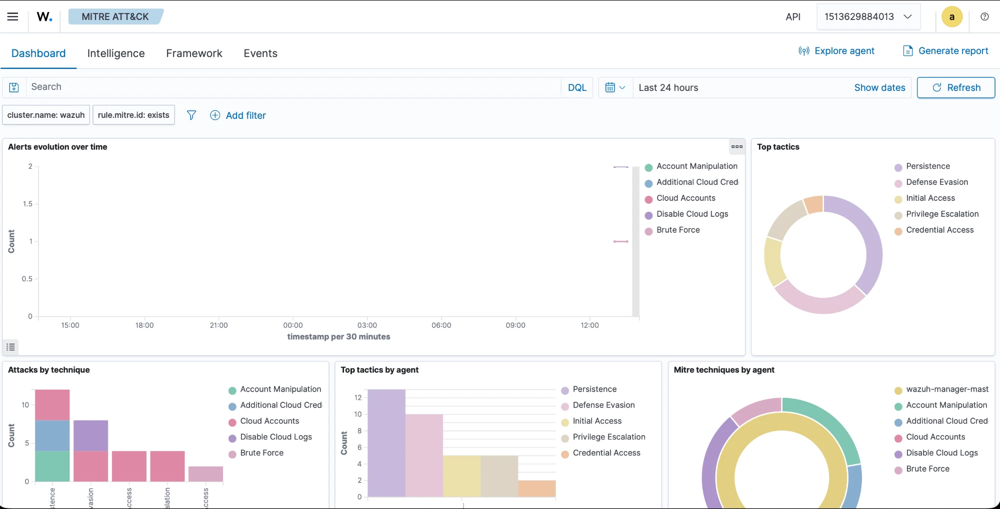
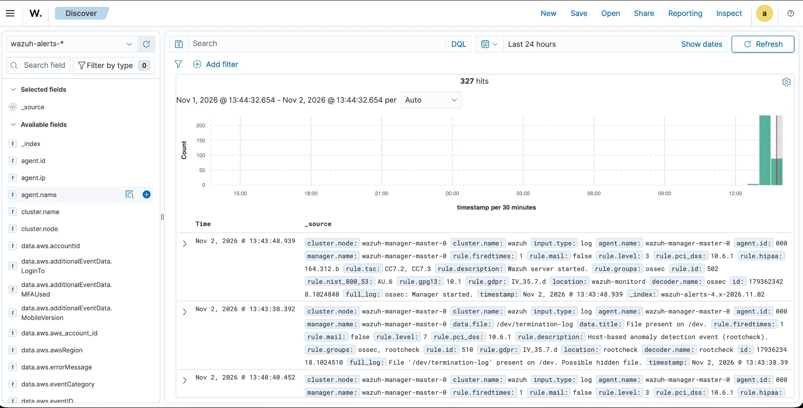

# SIEM as code: Wazuh on Kubernetes

A reproducible [Wazuh](https://wazuh.com) SIEM, defined entirely in Git and deployed with Argo CD.
Nothing is configured by hand: certificates, secrets, detection rules, decoders, integrations,
dashboards, backups and single sign-on all come from files in this repository.

The goal is **a SIEM you can rebuild from scratch with one command and review in a pull request**. This
repository shows it on a local [kind](https://kind.sigs.k8s.io) cluster. Because you rarely have a spare AWS
account, GitHub organization, Slack workspace and Opsgenie tenant to test with, those services are replaced
by small in-cluster stand-ins; the Wazuh configuration is written the way it would be in production.
[Deploying to a production cluster](#deploying-to-a-production-cluster) lists what to change and what it
assumes.



*Wazuh's MITRE ATT&CK view after a few minutes of simulated traffic: the techniques come from the custom
rules in `rules/` (account manipulation, disabled cloud logs, brute force...).*



*Discover over `wazuh-alerts-*`: alerts from the manager, the node agent, the AWS wodle and the GitHub
events, all indexed through Filebeat.*

## Contents

1. [What you get](#what-you-get)
2. [Architecture](#architecture)
3. [Repository layout](#repository-layout)
4. [Step by step](#step-by-step)
5. [Run it locally](#run-it-locally)
6. [Deploying to a production cluster](#deploying-to-a-production-cluster)
7. [Gotchas we hit](#gotchas-we-hit)
8. [License](#license)

## What you get

| Capability | How it is done here |
|---|---|
| GitOps deployment | Argo CD, app of apps, sync waves |
| TLS everywhere | cert-manager issues the indexer, manager and dashboard certificates |
| Cloud ingestion | AWS CloudTrail through the `aws-s3` wodle; GitHub audit log events |
| Host and container ingestion | Wazuh agent DaemonSet reading node and container logs |
| Detection as code | Custom rules and decoders in Git, pushed through the Wazuh API, with tests |
| Alerting | Slack as the notification channel, Opsgenie / JSM Operations as the paging channel |
| Dashboards as code | Generated saved objects, imported through the dashboard API |
| Backups and retention | Snapshots to S3 (daily, SLM) and index lifecycle management (ISM) |
| Single sign-on | OIDC with Dex, roles mapped from claims |

## Architecture

```
                        Git (this repository)
                                 |
                                 v
 kind / Kubernetes ----------- Argo CD ---- root app ---- apps/*.yaml
                                 |
     +---------------+-----------+------------+----------------+---------------+
     |               |           |            |                |               |
 cert-manager     wazuh          s3        github-mock    webhook-mock        dex
 (PKI)            |              (AWS S3    (GitHub        (Slack and       (OIDC IdP)
                  |               stand-in) stand-in)      Opsgenie
                  |                 |           |           stand-in)
   +--------------+------+          |           | syslog       ^
   |              |      |          |           v              | alerts
 indexer  <--- manager ---+--- aws-s3 wodle    manager ---------+
 (+S3 snapshots)  ^     dashboard   (CloudTrail)
                  |
        node agent DaemonSet (host and container logs)
```

| Application | Namespace | Role |
|---|---|---|
| `cert-manager` | `cert-manager` | Certificate authority machinery |
| `wazuh` | `wazuh` | Indexer, manager (single node), dashboard, node agent, plus the Jobs that apply rules, dashboards and backup policy |
| `s3` | `s3` | SeaweedFS standing in for AWS S3; a CronJob writes synthetic CloudTrail files |
| `github-mock` | `github-mock` | Generates random GitHub audit-log events and sends them over syslog |
| `webhook-mock` | `webhook-mock` | Receives what Wazuh sends to Slack and Opsgenie and shows it on a web page |
| `dex` | `dex` | OIDC provider for single sign-on |

Versions: Wazuh 4.14.9, [morgoved/wazuh-helm](https://github.com/morgoved/wazuh-helm) chart 2.4.0, Argo CD
chart 10.11.6, cert-manager 1.21.3, Dex 2.44.0.

## Repository layout

| Path | Purpose |
|---|---|
| `kind/` | Local cluster definition |
| `bootstrap/` | Argo CD values and the root Application |
| `apps/` | One Argo CD Application per component |
| `values/` | Helm values for Wazuh and cert-manager |
| `kustomize/wazuh/` | The Wazuh chart rendered through Kustomize, sync waves, and the Jobs that configure Wazuh |
| `manifests/` | The stand-ins: `s3`, `github-mock`, `webhook-mock`, `dex` |
| `rules/`, `decoders/` | Custom Wazuh rules and decoders (`iac-*.xml`), pushed through the API |
| `integrations/` | Opsgenie / JSM Operations integration script |
| `dashboards/` | Dashboard generator and the NDJSON it produces |
| `indexer/` | Snapshot repository, backup policy and index lifecycle policy (JSON) |
| `tests/events/` | One event per custom rule, named after the rule id it must trigger |
| `scripts/` | Bootstrap, secret generation, logtest, rule / backup / SSO tests, local git server |

## Step by step

### 1. Cluster and Argo CD

The only imperative step. `scripts/bootstrap.sh` creates the kind cluster, installs Argo CD with Helm and
generates the secrets. Everything after that is Git.

```yaml
# kind/cluster.yaml (excerpt): the dashboard and Dex are published on the host
nodes:
  - role: control-plane
    extraPortMappings:
      - {containerPort: 30443, hostPort: 8443, protocol: TCP}   # dashboard   -> http://localhost:8443
      - {containerPort: 30556, hostPort: 5556, protocol: TCP}   # Dex (OIDC)  -> http://dex.localhost:5556
```

Argo CD cannot read a local directory, so `scripts/serve-repo.sh` serves the repository over `git://`. In a
real setup `repoURL` is a GitHub or GitLab URL and this script disappears.

### 2. Secrets

`scripts/gen-secrets.sh` creates random passwords directly in the cluster and **never writes a password to
Git**. The only thing committed is the bcrypt hash of the indexer and dashboard users, because Argo CD
renders charts with `helm template`, where the chart's Secret `lookup` does not work:

```bash
rand()   { openssl rand -base64 96 | tr -dc 'A-Za-z0-9' | cut -c "1-${1:-24}"; }
bcrypt() { htpasswd -bnBC 12 "" "$1" | tr -d ':\n' | sed 's/^\$2y/$2a/'; }
```

```yaml
# values/wazuh-credentials.yaml (generated; hashes only)
indexer:
  cred:
    passwordHash: "$2a$12$..."
```

The chart then reads the rest through `existingSecret`: `wazuh-indexer-cred`, `wazuh-dashboard-cred`,
`wazuh-api-cred`, `wazuh-authd-pass` and `wazuh-cluster-key`.

### 3. App of apps and ordering

A root Application watches `apps/` and creates one Application per file. Sync waves order them: cert-manager
and the S3 stand-in first, Wazuh after.

```yaml
# apps/wazuh.yaml (excerpt)
metadata:
  name: wazuh
  annotations:
    argocd.argoproj.io/sync-wave: "1"
spec:
  source:
    repoURL: git://host.docker.internal:9418/wazuh-kubernetes
    targetRevision: main
    path: kustomize/wazuh
  syncPolicy:
    automated: {prune: true, selfHeal: true}
    syncOptions: [CreateNamespace=true, ServerSideApply=true]
```

### 4. Wazuh and its PKI

The chart is rendered by Kustomize (`kustomize/wazuh/kustomization.yaml`) because the chart creates
cert-manager `Certificate`s and the StatefulSets that mount their Secrets in the same release. Argo CD applies
the StatefulSets first and waits for them to be healthy, but they cannot start without the certificates: a
deadlock. Kustomize adds sync waves to the PKI resources the chart does not annotate:

```yaml
helmCharts:
  - name: wazuh
    repo: https://morgoved.github.io/wazuh-helm/
    version: 2.4.0
    releaseName: wazuh
    valuesFile: ../../values/wazuh.yaml
    additionalValuesFiles: [../../values/wazuh-credentials.yaml]

patches:                      # selfsigned Issuer -> root CA -> CA Issuer -> component certificates
  - target: {kind: Issuer, name: wazuh-selfsigned-issuer}
    patch: |-
      apiVersion: cert-manager.io/v1
      kind: Issuer
      metadata:
        name: wazuh-selfsigned-issuer
        annotations: {argocd.argoproj.io/sync-wave: "-3"}
  # ... root CA at -2, CA issuer at -2, admin/dashboard/filebeat/node certificates at -1
```

The deployment is single node: one indexer, one manager, no workers, one dashboard. The chart's
`autoreload: enabled` rolls the manager whenever its `ossec.conf` changes.

### 5. Ingestion

**AWS CloudTrail.** The `aws-s3` wodle reads CloudTrail logs from a bucket. Here the bucket lives in
SeaweedFS and `service_endpoint` points to it; in AWS you drop that line. A CronJob in `manifests/s3` uploads a
fresh synthetic CloudTrail file every ten minutes (a failed login, a root login without MFA, `StopLogging`,
an `AdministratorAccess` attachment...).

```xml
<!-- values/wazuh.yaml (excerpt) -->
<wodle name="aws-s3">
  <interval>5m</interval>
  <bucket type="cloudtrail">
    <name>wazuh-cloudtrail</name>
    <aws_profile>default</aws_profile>
    <service_endpoint>http://s3.s3.svc.cluster.local:8333</service_endpoint>
    <regions>eu-west-1</regions>
  </bucket>
</wodle>
```

**GitHub.** Wazuh's `github` module only talks to `api.github.com` (there is no setting for another URL, and
it needs GitHub Enterprise Cloud), so it cannot be pointed at a mock. Instead `github-mock` emits events in
the GitHub audit-log schema, wrapped the way the module wraps them (`integration: github`), and sends them to
a syslog listener on the manager. Wazuh's native GitHub ruleset (91100-91449) handles them:

```json
{"integration":"github","github":{"@timestamp":1793625000000,"action":"repo.destroy","actor":"eve-contractor",
 "actor_location":{"country_code":"RU"},"org":"acme-corp","repo":"acme-corp/billing-service","operation_type":"remove"}}
```

Every so often the mock simulates an incident (one actor deleting four repositories in a row) so the
correlation rule below has something to catch.

**Node and container logs.** The agent DaemonSet mounts the node's `/var/log`. The manager pushes the
`localfile` configuration to the agent group, so nothing is baked into an image:

```yaml
# values/wazuh.yaml (excerpt)
wazuh:
  agentGroupConf:
    - name: default
      agent: |
        <agent_config>
          <localfile>
            <log_format>syslog</log_format>
            <location>/host/var/log/pods/kube-system_*/*/*.log</location>
          </localfile>
        </agent_config>
```

Container runtime lines look like `2026-11-02T13:40:12Z stderr F <message>`. A custom decoder
(`decoders/iac-cri.xml`) extracts the message. The syslog predecoder reads `stderr` as a hostname, so the
decoder has to expect `F <message>`, not the whole line (see [gotchas](#gotchas-we-hit)).

### 6. Detection as code

Rules and decoders are plain XML files in Git. A PostSync Job uploads them through the Wazuh API, which
validates the syntax, and restarts the manager only if something changed. Files are named `iac-*.xml`; the
Job also deletes managed files that no longer exist in Git.

```xml
<!-- rules/iac-aws-cloudtrail.xml (excerpt): the native rule logs a root login at level 3 -->
<rule id="100100" level="12">
  <if_sid>80253</if_sid>
  <field name="aws.userIdentity.type">^Root$</field>
  <field name="aws.additionalEventData.MFAUsed">^No$</field>
  <description>AWS: root account console login without MFA</description>
  <mitre><id>T1078.004</id></mitre>
</rule>
```

```xml
<!-- rules/iac-github.xml: correlation, three repository deletions by one actor in five minutes -->
<rule id="100200" level="14" frequency="3" timeframe="300">
  <if_matched_sid>91320</if_matched_sid>
  <same_field>github.actor</same_field>
  <description>GitHub: mass repository deletion by $(github.actor)</description>
</rule>
```

```python
# kustomize/wazuh/files/rules-sync.py (excerpt)
status, body = call("PUT", f"/{kind}/files/{name}?{q}", token, content)   # q: overwrite=true&relative_dirname=etc/rules
check(status, body, f"upload {kind}/{name}")
```

| Rules | Detects |
|---|---|
| `100100`-`100105` | AWS: root login without MFA, CloudTrail tampering, admin policy attached, access key created, security group open to the world, console brute force |
| `100200` | GitHub: mass repository deletion |
| `100300`-`100320` | Kubernetes nodes: API server authentication failures (and bursts), crashing containers |

Every rule has a test event named after the rule it must trigger. `scripts/test-rules.sh` runs them through
the live manager with `wazuh-logtest` over the API:

```console
$ scripts/test-rules.sh
PASS 100100-aws-root-login-no-mfa.json -> 100100
PASS 100104-aws-sg-open-to-world.json -> 100104
PASS 100310-k8s-apiserver-auth-failure.log -> 100310
...
```

### 7. Notifications and paging

Two channels with different jobs. **Slack is the notification channel**: broad, level 8 and up, so a person
sees what is happening. **Opsgenie / JSM Operations is the paging channel**: level 12 and up, mapped to
priorities. Both endpoints are the stand-in in this repository.

```xml
<integration>
  <name>slack</name>
  <hook_url>http://webhook-mock.webhook-mock.svc.cluster.local:8080/slack/services/T0/B0/mock</hook_url>
  <level>8</level>
  <alert_format>json</alert_format>
</integration>
<integration>
  <name>custom-opsgenie</name>
  <hook_url>http://webhook-mock.webhook-mock.svc.cluster.local:8080/opsgenie/v2/alerts</hook_url>
  <level>12</level>
  <alert_format>json</alert_format>
</integration>
```

Slack is a native Wazuh integration. Opsgenie is not, so `integrations/custom-opsgenie.py` builds the alert.
JSM Operations takes the same request, so only `hook_url` differs. The API key is read from an environment
variable fed by a Secret, not from `ossec.conf`.

```python
def priority(level):
    return "P1" if level >= 14 else "P2" if level >= 12 else "P3" if level >= 10 else "P4" if level >= 7 else "P5"
```

To see what would have been sent, port-forward the receiver and open it:

```bash
kubectl --context kind-wazuh -n webhook-mock port-forward svc/webhook-mock 8080:8080   # http://localhost:8080
```

### 8. Backups and data lifecycle

The Wazuh indexer image is OpenSearch 2.19.6 **without** the `repository-s3` plugin. An init container installs
it (pinned version, SHA-512 checked) into an `emptyDir` mounted over `plugins/repository-s3` and builds a
keystore holding the S3 credentials, which are secure settings and cannot come from environment variables.
A PostSync Job then applies three JSON files from `indexer/`:

```json
{"type": "s3", "settings": {"bucket": "wazuh-snapshots", "base_path": "wazuh",
 "endpoint": "http://s3.s3.svc.cluster.local:8333", "protocol": "http", "path_style_access": true}}
```

- **Snapshot policy (`slm-wazuh-daily.json`)**: daily at 03:00 UTC, snapshots kept 90 days (at least 7).
- **Lifecycle policy (`ism-wazuh-alerts.json`)**: alerts stay hot for 7 days, then are force-merged and made
  read-only, and are deleted at day 30. Snapshots keep the data for 90.

```json
"states": [
  {"name": "hot",    "transitions": [{"state_name": "warm",   "conditions": {"min_index_age": "7d"}}]},
  {"name": "warm",   "actions": [{"force_merge": {"max_num_segments": 1}}, {"read_only": {}}],
                      "transitions": [{"state_name": "delete", "conditions": {"min_index_age": "30d"}}]},
  {"name": "delete", "actions": [{"delete": {}}]}
]
```

`scripts/test-backup.sh` proves the round trip: it snapshots the alerts indices, restores them under another
name, compares document counts and cleans up.

### 9. Dashboards as code

No ready-made community dashboards exist for Wazuh's field layout, and the Wazuh app already ships its own
module views (MITRE ATT&CK, Cloud Security) inside the plugin. `dashboards/build.py` generates two saved-object
dashboards, **AWS CloudTrail (IaC)** and **GitHub audit (IaC)**, focused on the custom rules and on who did
what. A PostSync Job imports the NDJSON files through the dashboard's saved objects API.

```python
pie("iac-aws-custom-rules", "AWS: custom detections", "rule.description", f"{AWS} and rule.groups:iac")
```

### 10. Single sign-on

Dex is a small OIDC provider with two demo users. The chart's native OIDC support configures the dashboard
and the indexer; the basic login stays as a fallback.

```yaml
# values/wazuh.yaml (excerpt)
dashboard:
  sso:
    oidc:
      enabled: true
      primary: true
      url: http://dex.localhost:5556/.well-known/openid-configuration
      issuer: http://dex.localhost:5556
      baseRedirectUrl: http://localhost:8443
      config: {subjectKey: email, rolesKey: email}
      roleMappings:
        allAccess: {backendRoles: ["admin@wazuh.local"]}
        kibanaUser: {backendRoles: ["analyst@wazuh.local"]}
```

Two local-only tricks. Browsers resolve `*.localhost` to loopback, so the issuer is `dex.localhost`; inside the
cluster the Wazuh pods map that name to Dex's fixed ClusterIP with `hostAliases`. And Dex static users carry no
groups, so roles are mapped from the `email` claim; with a real identity provider you map groups instead.

```console
$ scripts/test-sso.sh analyst          # the whole OIDC login, no browser
landed on: http://localhost:8443/app/wz-home
user_name    : analyst@wazuh.local
roles        : ['own_index', 'kibana_user']
```

## Run it locally

Requirements: Docker, [kind](https://kind.sigs.k8s.io), `kubectl`, Helm 3, `htpasswd`, `openssl` and Python 3.

```bash
scripts/bootstrap.sh        # kind cluster + Argo CD + secrets
git add values/wazuh-credentials.yaml && git commit -m "Wazuh credential hashes"
scripts/serve-repo.sh &     # serves this repository to Argo CD over git://
kubectl --context kind-wazuh apply -f bootstrap/root-app.yaml
kubectl --context kind-wazuh -n argocd get applications   # wait for Synced / Healthy
```

Then:

- Dashboard: http://localhost:8443. Log in as `admin` (password from `wazuh-indexer-cred`) or with "Log in
  with Dex (SSO)". On a cluster created without the Dex port mapping run
  `kubectl --context kind-wazuh -n dex port-forward svc/dex 5556:5556`.
- Passwords:

  ```bash
  kubectl --context kind-wazuh -n wazuh get secret wazuh-indexer-cred -o jsonpath='{.data.INDEXER_PASSWORD}' | base64 -d
  kubectl --context kind-wazuh -n dex get secret dex-demo-passwords -o jsonpath='{.data.admin}' | base64 -d
  ```

- Checks: `scripts/test-rules.sh`, `scripts/test-backup.sh`, `scripts/test-sso.sh`.
- Provoke a node-log alert: `curl -k -H "Authorization: Bearer bad" https://127.0.0.1:<api-server-port>/api/v1/namespaces`.
  `kubectl --token` will not do: the client certificate in your kubeconfig authenticates first.

## Deploying to a production cluster

Everything above is tested on kind. This section is **not tested**: it is the list of changes this design
needs and what it assumes. Treat each item as a pull request against this repository, not a different
repository.

### Assumptions

| Assumption | Why it matters |
|---|---|
| Kubernetes 1.25+ with a CNI that enforces `NetworkPolicy` | The chart ships policies that isolate the indexer, manager and dashboard |
| A fast `StorageClass` and enough disk | The indexer holds the alerts; 10 Gi here is a toy value |
| **Argo CD** installed and allowed to reach your Git host | This repository is an app of apps; Flux would need a translation |
| **cert-manager** installed, with a `ClusterIssuer` that can sign server and client certificates | The indexer and manager use mutual TLS between components |
| **External Secrets Operator** (or equivalent) and a secret store | Replaces `scripts/gen-secrets.sh` |
| An **OIDC provider** (Entra ID, Okta, Keycloak...) with a `groups` claim | Replaces Dex |
| DNS, an Ingress controller or Gateway API, and a public TLS certificate for the dashboard | Replaces the NodePort |
| A way for agents outside the cluster to reach the manager (LoadBalancer, ports 1514 and 1515) | Only if you enroll hosts outside Kubernetes |
| An AWS account with CloudTrail writing to S3, and IAM roles for the pods | Replaces SeaweedFS and static credentials |
| A GitHub **Enterprise Cloud** organization and a token | The audit-log API needs it |
| A Slack incoming webhook and an Opsgenie / JSM Operations API key | Replaces the webhook mock |
| An image registry you control | To pin and mirror images and bake in the S3 plugin |

### 1. Git remote and Argo CD

Point every Application at the real repository and remove the local git server.

```yaml
# bootstrap/root-app.yaml and apps/*.yaml
source:
  repoURL: https://github.com/acme/siem.git        # was git://host.docker.internal:9418/wazuh-kubernetes
  targetRevision: main
```

Register repository credentials in Argo CD (a deploy key or token, ideally also from your secret store), and
put the Applications in an Argo CD `AppProject` that limits destinations to the namespaces you use. For
several environments use overlays (`overlays/staging`, `overlays/prod`) or an `ApplicationSet` rather than
copying the repository.

### 2. Drop the stand-ins

Delete `apps/s3.yaml`, `apps/github-mock.yaml`, `apps/webhook-mock.yaml` and `apps/dex.yaml`, and the matching
directories under `manifests/`. Then remove everything in `values/wazuh.yaml` that only existed to talk to
them: the `hostAliases`, the egress to the `s3`, `dex` and `webhook-mock` namespaces, the syslog `<remote>`
and its ingress, `kustomize/wazuh/syslog-service.yaml`, and the NodePort on the dashboard.

### 3. Certificates

If the cluster already runs cert-manager, delete `apps/cert-manager.yaml` and sign with your issuer instead of
the chart's self-signed CA:

```yaml
certificates:
  enabled: true
  issuer:
    name: corp-internal-ca
    type: ClusterIssuer
```

Keep the sync-wave patch for the `Certificate`s (`wazuh-admin`, `wazuh-dashboard`, `wazuh-filebeat`,
`wazuh-node`, wave `-1`); drop the ones for the chart's own Issuers and root CA, which no longer exist. After
a certificate renews the pods must reload it: `autoreload` handles config changes, so check how your
renewal window and a rolling restart fit together.

### 4. Secrets from a secret store

Replace `scripts/gen-secrets.sh` with `ExternalSecret`s that produce the same Secrets, and keep the chart's
`existingSecret` values unchanged:

```yaml
apiVersion: external-secrets.io/v1beta1
kind: ExternalSecret
metadata: {name: wazuh-indexer-cred, namespace: wazuh}
spec:
  secretStoreRef: {kind: ClusterSecretStore, name: aws-secrets-manager}
  target: {name: wazuh-indexer-cred}
  data:
    - {secretKey: INDEXER_USERNAME, remoteRef: {key: prod/wazuh/indexer, property: username}}
    - {secretKey: INDEXER_PASSWORD, remoteRef: {key: prod/wazuh/indexer, property: password}}
```

Do the same for the dashboard, API, authd and cluster-key Secrets, the OIDC client, the Opsgenie key and the
AWS keys if you still need any. One limitation stays: the indexer and dashboard users are defined by bcrypt
hashes in `values/wazuh-credentials.yaml`, because Argo CD renders without cluster access. Regenerate the hash
whenever you rotate the password, or supply `indexer.config.internalUsers` yourself. A second one is
**secrets inside `ossec.conf`** (the GitHub token, the Slack webhook): the chart renders `ossec.conf` into a
ConfigMap, so those values have to be injected by a templating step (Argo CD Vault Plugin, or a pipeline step
before commit). This repository does not solve that.

### 5. Exposing the dashboard

```yaml
dashboard:
  service: {type: ClusterIP}
  ingress:
    enabled: true
    className: nginx
    host: wazuh.example.com
    tls: [{hosts: [wazuh.example.com], secretName: wazuh-dashboard-tls}]
    annotations: {cert-manager.io/cluster-issuer: letsencrypt}
```

The chart also supports the Gateway API (`dashboard.gateway`). If you want agents from outside the cluster:

```yaml
wazuh:
  loadBalancer:
    enabled: true
    ports: ["registration", "agents-events"]
    loadBalancerSourceRanges: ["10.0.0.0/8"]
```

### 6. Single sign-on with your identity provider

Remove Dex and map **groups**, not emails:

```yaml
dashboard:
  sso:
    oidc:
      enabled: true
      primary: true            # keep: see the gotcha about the indexer's OIDC domain
      url: https://login.example.com/realms/corp/.well-known/openid-configuration
      issuer: https://login.example.com/realms/corp
      logoutUrl: https://login.example.com/realms/corp/protocol/openid-connect/logout
      baseRedirectUrl: https://wazuh.example.com
      scope: "openid profile email groups"
      existingSecret: wazuh-oidc
      config: {subjectKey: preferred_username, rolesKey: groups}
      roleMappings:
        allAccess: {backendRoles: ["wazuh-admins"]}
        kibanaUser: {backendRoles: ["wazuh-analysts"]}
      idp:
        enableSSL: true        # plus pemtrustedcasContent if the IdP uses a private CA
```

Allow egress from the indexer and the dashboard to the IdP on 443, and register
`https://wazuh.example.com/auth/openid/login` as the redirect URI.

### 7. AWS: CloudTrail and snapshots without static keys

Give the manager and the indexer pods an IAM role (IRSA or EKS Pod Identity) and remove the credentials file
and `service_endpoint`:

```xml
<wodle name="aws-s3">
  <interval>10m</interval>
  <bucket type="cloudtrail">
    <name>acme-org-cloudtrail</name>
    <aws_organization_id>o-xxxxxxxxxx</aws_organization_id>
    <regions>eu-west-1,us-east-1</regions>
  </bucket>
</wodle>
```

```json
{"Version": "2012-10-17", "Statement": [
  {"Effect": "Allow", "Action": ["s3:GetObject", "s3:ListBucket"],
   "Resource": ["arn:aws:s3:::acme-org-cloudtrail", "arn:aws:s3:::acme-org-cloudtrail/*"]},
  {"Effect": "Allow", "Action": "kms:Decrypt", "Resource": "arn:aws:kms:eu-west-1:111111111111:key/..."}]}
```

For snapshots, drop `endpoint`, `protocol` and `path_style_access` from `indexer/snapshot-repository.json`, use
a bucket with versioning, encryption and a lifecycle rule, and **bake the plugin into an image** instead of
downloading it when the pod starts (which is also why the indexer needs egress to the internet here):

```dockerfile
FROM wazuh/wazuh-indexer:4.14.9
RUN /usr/share/wazuh-indexer/bin/opensearch-plugin install --batch repository-s3
```

Then delete the `s3-plugin` init container, its volumes and the 443 egress rule. How the plugin authenticates
with an IAM role (web identity) is something to validate against the OpenSearch `repository-s3` documentation;
only the static-key path (keystore) was exercised here.

### 8. GitHub, Slack and Opsgenie for real

Delete the mock and add the module, with the token injected as described in the secrets section:

```xml
<github>
  <enabled>yes</enabled>
  <interval>5m</interval>
  <only_future_events>yes</only_future_events>
  <api_auth>
    <org_name>acme-corp</org_name>
    <api_token>${GITHUB_TOKEN}</api_token>
  </api_auth>
  <api_parameters><event_type>all</event_type></api_parameters>
</github>
```

Change the two `hook_url`s to the real Slack webhook and to `https://api.opsgenie.com/v2/alerts` (the EU
region uses `api.eu.opsgenie.com`; JSM Operations uses the same request). The `NetworkPolicy` egress must allow
443 to those hosts, which needs a CNI that can match by name (for example Cilium) or an egress proxy.

### 9. Size it and make it highly available

```yaml
indexer:
  replicas: 3
  storageClass: gp3
  storageSize: 500Gi
  resources: {requests: {cpu: "2", memory: 8Gi}, limits: {memory: 8Gi}}
  env: {OPENSEARCH_JAVA_OPTS: "-Xms4g -Xmx4g"}
wazuh:
  worker: {enabled: true, replicas: 2, storageClass: gp3}
  master: {storageClass: gp3, storageSize: 50Gi}
```

With more than one indexer, give the alert indices replicas. Agents then connect to the workers, so check
`agent.joinManager` and the `loadBalancer` ports. Keep the PodDisruptionBudgets the chart creates.

### 10. Agents and node logs

- The DaemonSet image is `kinseii/wazuh-agent`, a community image (the chart's default, pinned by digest here
  because only `latest` ships arm64). On amd64 nodes use a tag; consider building your own from the official
  package.
- On managed Kubernetes (EKS, GKE, AKS) the control plane does not run on your nodes, so
  `rules/iac-k8s-nodes.xml` will not see API server logs. Collect the provider's audit logs instead, for
  example CloudWatch Logs through the `aws-s3` wodle's `cloudwatchlogs` service. The CRI decoder still helps
  for workloads.
- Review which namespaces `agentGroupConf` reads before pointing it at busy ones.

### 11. Run the checks in CI

```yaml
# a pull request pipeline, sketch
- run: python3 dashboards/build.py && git diff --exit-code            # generated files are up to date
- run: kubectl kustomize --enable-helm --load-restrictor LoadRestrictionsNone kustomize/wazuh | kubeconform -strict -ignore-missing-schemas
- run: scripts/bootstrap.sh && scripts/test-rules.sh                  # on an ephemeral kind cluster
```

### Production checklist

- [ ] `repoURL` points to your Git host and Argo CD has credentials for it
- [ ] Stand-ins and their policies removed; real endpoints configured
- [ ] cert-manager `ClusterIssuer` referenced; certificate renewal tested
- [ ] All Secrets come from the secret store; no password or token in Git
- [ ] Dashboard behind TLS, SSO with group mapping; the basic login restricted or disabled
- [ ] IAM roles for CloudTrail and snapshots; bucket versioning, encryption and lifecycle
- [ ] Snapshot **restore** rehearsed (`scripts/test-backup.sh` is the template)
- [ ] Storage sized from your event rate; indexer replicas and index replicas set
- [ ] Images pinned (digests) and mirrored; S3 plugin baked in
- [ ] `scripts/test-rules.sh` runs in CI

## Gotchas we hit

Each of these cost real time. They are written down because the next person will meet them too.

- **PKI deadlock.** Argo CD applies StatefulSets before `Certificate`s and waits for them to be healthy, but
  they need the certificates' Secrets. Fixed with sync waves added by Kustomize.
- **Hashed ConfigMap names need a namespace.** Kustomize only rewrites a volume's ConfigMap reference when the
  generated ConfigMap and the consumer share a namespace. Without it a script change does not roll the pod.
  Also, a per-generator `disableNameSuffixHash: false` loses against a global `true`.
- **Filebeat sent no alerts for hours.** The chart's own indexer Secret holds `INDEXER_USERNAME` as well as the
  password; an `existingSecret` must too. The indexer answered 401 and the dashboard warned about a missing
  `wazuh-alerts-*` template.
- **Indexer OIDC domain.** With the OIDC domain ordered first and `challenge: true`, every request without a
  Bearer token gets an immediate 401 and basic auth is never tried, so the dashboard cannot reach the indexer.
  `primary: true` makes it non-challenging.
- **Dex has no `preferred_username` for static users.** Use `email` as the subject.
- **CRI lines and the syslog predecoder.** The predecoder takes the ISO timestamp and reads `stderr` as a
  hostname, so decoders see `F <message>`.
- **A crash-looping StatefulSet pod does not pick up a fixed spec.** Argo CD's sync keeps waiting for it. Delete
  the pod.
- **Wazuh's `github` module has no base-URL setting**, so it cannot talk to a mock.
- **`curl` treats `*.localhost` as loopback** and ignores `hostAliases`; use `--resolve` to test from a pod.
- **`kubectl --token=bad` authenticates anyway** if your kubeconfig has a client certificate.

## License

[MIT](LICENSE). The Wazuh chart (Apache-2.0) and the container images keep their own licenses.
